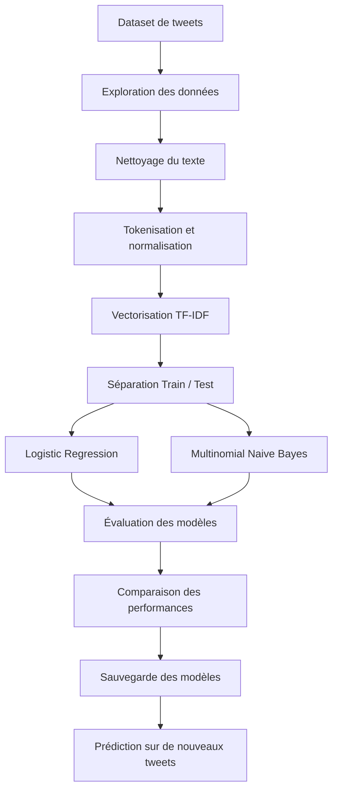

# NLP — Classification de tweets et analyse de sentiment

**Projet de Machine Learning supervisé : classification automatique de tweets en sentiments positifs et négatifs à l'aide de TF-IDF, Logistic Regression et Naive Bayes.**

L'objectif est de comprendre comment un modèle de Machine Learning transforme un texte en représentation numérique, apprend à partir d'exemples étiquetés et prédit le sentiment d'un nouveau tweet.

---

## Objectifs du projet

Ce projet explore les principales étapes d'un pipeline de traitement automatique du langage naturel (*Natural Language Processing — NLP*) :

- Nettoyer et normaliser des données textuelles.
- Transformer des tweets en vecteurs numériques avec TF-IDF.
- Entraîner plusieurs modèles de classification.
- Comparer leurs performances sur les données d'entraînement et de test.
- Évaluer les prédictions à l'aide de métriques adaptées.
- Sauvegarder les modèles entraînés pour effectuer de nouvelles prédictions.

**Problématique :** comment déterminer automatiquement si un tweet exprime un sentiment positif ou négatif à partir de son contenu textuel ?

> Un modèle de classification produit une prédiction fondée sur les régularités apprises dans les données. Cette prédiction n'est pas une certitude absolue.

---

## Dataset

Le projet utilise un jeu de données de tweets annotés pour l'analyse de sentiment.

| Caractéristique | Description |
|---|---|
| Source | [Sentiment140 — Kaggle](https://www.kaggle.com/datasets/kazanova/sentiment140) |
| Taille utilisée | 20 000 tweets, selon la configuration du projet |
| Classes | Positif et négatif |
| Variable cible | `targets` |
| Texte original | `text` |
| Texte prétraité | `text_clean` |

**Encodage des classes :**

- `0` : sentiment négatif
- `1` : sentiment positif

Le dataset Sentiment140 original est plus volumineux et utilise un encodage particulier des sentiments. Les 20 000 tweets correspondent donc au sous-ensemble utilisé dans ce projet. Vérifie également que le prétraitement des étiquettes conserve bien la correspondance entre les classes et les valeurs `0` et `1`.

---

## Architecture du pipeline NLP

Le pipeline suit les étapes classiques d'un projet de classification de texte.



### Étapes de traitement

**1. Prétraitement du texte**

- Conversion en minuscules.
- Suppression des URL et des mentions.
- Nettoyage de la ponctuation et des chiffres, selon les règles retenues.
- Tokenisation.
- Suppression des mots vides (*stop words*).
- Lemmatisation.

**2. Vectorisation TF-IDF**

Les tweets sont transformés en vecteurs numériques. La pondération TF-IDF permet de représenter l'importance relative des mots dans les documents.

**3. Séparation des données**

Les données sont divisées en deux ensembles :

- Entraînement : 80 %.
- Test : 20 %.

La séparation est stratifiée afin de conserver, autant que possible, la proportion des classes dans les deux ensembles.

**4. Entraînement des modèles**

Deux algorithmes sont comparés :

- **Logistic Regression** : modèle de classification linéaire permettant d'estimer la probabilité d'appartenance à une classe.
- **Multinomial Naive Bayes** : classifieur probabiliste fréquemment utilisé pour la classification de textes.

**5. Évaluation**

Les modèles sont comparés avec l'accuracy, la précision, le rappel, le F1-score et le ROC-AUC.

---

## Résultats expérimentaux

Les résultats ci-dessous correspondent aux valeurs obtenues lors des expériences du projet.

| Métrique | Logistic Regression — Train | Logistic Regression — Test | Naive Bayes — Train | Naive Bayes — Test |
|---|---:|---:|---:|---:|
| Accuracy | 84,6 % | 74,1 % | 87,4 % | 72,4 % |
| Precision | 83,9 % | 73,0 % | 89,6 % | 74,8 % |
| Recall | 85,6 % | 76,3 % | 84,7 % | 67,6 % |
| F1-score | 84,7 % | 74,6 % | 87,1 % | 71,0 % |
| ROC-AUC | — | 0,82 | — | 0,81 |

### Interprétation des résultats

**Logistic Regression** obtient les meilleurs résultats globaux sur le jeu de test :

- **Accuracy :** 74,1 %, contre 72,4 % pour Naive Bayes.
- **Recall :** 76,3 %, contre 67,6 %.
- **F1-score :** 74,6 %, contre 71,0 %.
- **ROC-AUC :** 0,82, contre 0,81.

Naive Bayes présente une précision légèrement supérieure sur le test (74,8 % contre 73,0 %). En revanche, Logistic Regression identifie une plus grande proportion des exemples positifs et obtient un meilleur équilibre global entre précision et rappel.

L'écart entre les performances d'entraînement et de test suggère une généralisation imparfaite pour les deux modèles. Il ne suffit toutefois pas, à lui seul, à établir un diagnostic complet de surapprentissage.

### Conclusion

Sur la base des métriques disponibles, **Logistic Regression est le modèle à privilégier pour cette expérience**. Il présente un meilleur rappel, un meilleur F1-score, une accuracy supérieure et un ROC-AUC légèrement plus élevé sur le jeu de test.

Ces résultats constituent une base de comparaison. Des expériences supplémentaires pourraient explorer le réglage des hyperparamètres, la validation croisée, les n-grammes et d'autres méthodes de représentation du texte.

---

## Structure du projet

```text
NLP-Sentiment-Analysis/
├── notebook.ipynb
├── models/
│   ├── lr_model.pkl
│   ├── nb_model.pkl
│   └── features.pkl
└── README.md
```

Le notebook contient le processus d'analyse, de prétraitement, d'entraînement et d'évaluation. Le dossier `models/` contient les objets sauvegardés pour réutiliser les modèles sans devoir les entraîner à nouveau.

> **À vérifier :** le code de prédiction ci-dessous charge `tfidf_vectorizer.pkl`, alors que l'arborescence initiale mentionne `features.pkl`. Utilise le nom réel du fichier sauvegardé par ton notebook et assure-toi qu'il contient bien le vectoriseur TF-IDF entraîné.

---

## Technologies utilisées

| Technologie | Utilisation |
|---|---|
| Python | Langage de programmation |
| pandas | Manipulation et exploration des données |
| re | Nettoyage textuel avec les expressions régulières |
| NLTK | Tokenisation, stop words et lemmatisation |
| scikit-learn | TF-IDF, classification et métriques d'évaluation |
| Matplotlib | Visualisation des résultats et des courbes ROC |
| joblib | Sauvegarde et chargement des modèles |

---

## Installation

### 1. Installer les dépendances

```bash
pip install pandas nltk scikit-learn matplotlib joblib
```

### 2. Télécharger les ressources NLTK

```python
import nltk

nltk.download("stopwords")
nltk.download("punkt")
nltk.download("wordnet")
```

Selon la version de NLTK utilisée et les fonctions de tokenisation du notebook, d'autres ressources peuvent être nécessaires. Si une erreur de ressource apparaît, installe uniquement la ressource indiquée par le message d'erreur.

### 3. Lancer le notebook

Ouvre `notebook.ipynb` dans Jupyter Notebook ou Visual Studio Code, puis exécute les cellules dans l'ordre.

---

## Utilisation des modèles sauvegardés

Après l'entraînement et la sauvegarde des modèles, il est possible de classifier un nouveau tweet.

```python
import joblib

# Charger les modèles entraînés
lr_model = joblib.load("models/lr_model.pkl")
nb_model = joblib.load("models/nb_model.pkl")

# Adapter ce chemin au nom réel du vectoriseur sauvegardé
vectorizer = joblib.load("models/tfidf_vectorizer.pkl")

# Exemple de tweet
tweet = ["I love this so much, amazing day!"]

# Transformer le texte en représentation TF-IDF
tweet_vector = vectorizer.transform(tweet)

# Prédictions
lr_prediction = lr_model.predict(tweet_vector)[0]
nb_prediction = nb_model.predict(tweet_vector)[0]

print(
    "Logistic Regression :",
    "Positif" if lr_prediction == 1 else "Négatif"
)

print(
    "Naive Bayes :",
    "Positif" if nb_prediction == 1 else "Négatif"
)
```

**Important :** le nouveau tweet doit subir le même prétraitement que celui utilisé pendant l'entraînement. Si le nettoyage est effectué séparément dans le notebook, applique cette même fonction avant la vectorisation.

---

## Concepts clés

### Bag of Words (BoW)

Méthode qui représente un document à partir des mots présents et de leurs fréquences. Dans sa forme classique, elle ne tient pas compte de l'ordre des mots.

### TF-IDF

Méthode qui pondère les termes selon leur fréquence dans un document et leur rareté dans le corpus. Elle aide à distinguer les mots potentiellement informatifs des mots très fréquents.

### Logistic Regression

Algorithme de classification qui estime une probabilité d'appartenance à une classe à partir des caractéristiques numériques du texte.

### Multinomial Naive Bayes

Classifieur probabiliste reposant sur le théorème de Bayes et une hypothèse d'indépendance conditionnelle entre les caractéristiques. Il est souvent utilisé comme modèle de référence pour la classification textuelle.

### Accuracy

Proportion totale de prédictions correctes parmi les exemples évalués.

### Precision

Parmi les exemples prédits comme appartenant à une classe, proportion de ceux qui appartiennent réellement à cette classe.

### Recall

Parmi les exemples appartenant réellement à une classe, proportion de ceux correctement identifiés par le modèle.

### F1-score

Moyenne harmonique de la précision et du rappel, utile pour apprécier leur équilibre.

### ROC-AUC

Mesure la capacité du modèle à distinguer les deux classes sur différents seuils de décision. Une valeur proche de 1 indique une bonne discrimination ; une valeur proche de 0,5 correspond approximativement à une discrimination aléatoire.

---

## Pistes d'amélioration

- Tester les unigrammes et les bigrammes dans TF-IDF.
- Optimiser les hyperparamètres avec `GridSearchCV` ou `RandomizedSearchCV`.
- Utiliser une validation croisée stratifiée.
- Examiner la matrice de confusion et les erreurs de classification.
- Comparer les modèles avec un jeu de test indépendant.
- Étudier l'apport de modèles plus avancés, notamment les représentations contextuelles et les modèles Transformers.

---

## Compétences développées

- Prétraitement et nettoyage de données textuelles.
- Représentation numérique de textes avec TF-IDF.
- Classification supervisée avec scikit-learn.
- Évaluation et comparaison de modèles de Machine Learning.
- Interprétation des métriques de classification.
- Sauvegarde et réutilisation de modèles entraînés.

---

*Projet pédagogique réalisé dans le cadre du cours NLP — Classification et analyse de sentiment.*